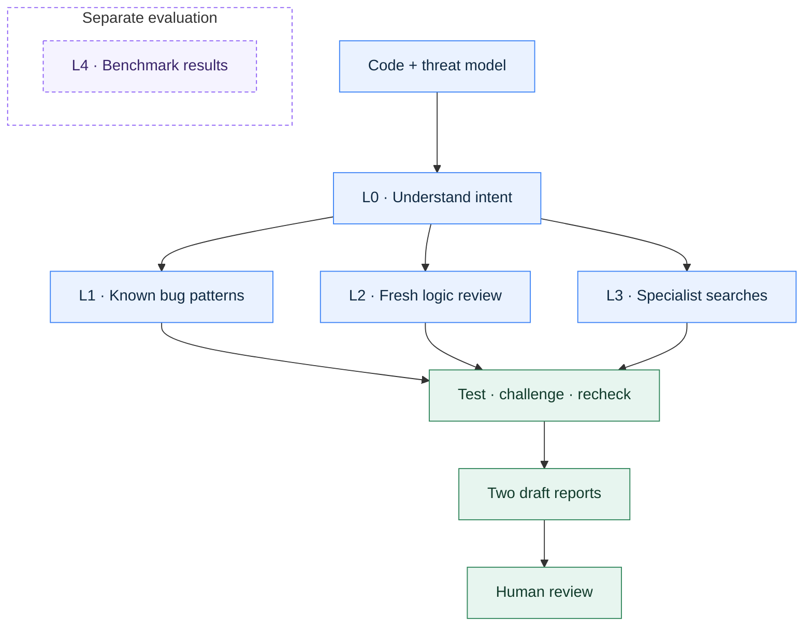

<div align="center">

# NEAR YoctoArmor v1

**A Slot Zero Security framework for finding vulnerabilities in NEAR contracts.**

<p>
  <a href="https://slotzerosecurity.com/"></a>
  <a href="https://slotzerosecurity.com/contact"></a>
  <a href="https://github.com/SlotZeroSecurity/audits"></a>
  <a href="https://x.com/Slot_Zero_Sec"></a>
</p>

[Install](#install) · [Run](#run-a-review) · [Threat model](#threat-model) · [How it works](#how-it-works) · [Specialists](#meet-the-specialists) · [Reports](#what-you-receive) · [Usage guide](docs/usage.md)

</div>

<a id="install"></a>

## 📦 Install

Open [Codex](https://learn.chatgpt.com/docs/build-skills) or [Claude Code](https://code.claude.com/docs/en/skills/) and paste:

```text
Install NEAR YoctoArmor v1 locally as a personal skill for this AI tool.
Clone branch v1 from https://github.com/SlotZeroSecurity/slotzero-nearshield.git
Install the complete package as near-yoctoarmor-v1 in this tool's supported
skills directory. Preserve any existing installation outside skill-discovery
directories and avoid duplicate copies.
Run scripts/near_audit.py doctor and scripts/maintain.py check with Python.
Show the installed path and how to invoke the skill.
```

You need Git, Python 3.10+, macOS or Linux, and repository access. Start a new chat after installation.
Designed for Codex; full Claude Code audit execution remains unverified. See [manual setup and other hosts](docs/usage.md#installation-alternatives).

<a id="run-a-review"></a>

## 🚀 Run a review

<a id="threat-model"></a>

### 🧭 First, the threat model

Put `THREAT_MODEL.md` in your project's root. Explain what needs protecting, what an attacker can do, who is trusted, and which rules must hold.
Use the [threat-model skill](https://github.com/openai/codex-security/tree/main/plugins/codex-security/skills/threat-model) to generate it, then review it yourself. See the [example and instructions](docs/usage.md#threat-model).
The audit stops if it is missing unless you explicitly choose to continue without it.

Then paste into Codex:

```text
$near-yoctoarmor-v1 Audit /absolute/path/to/near-project with --loop 1.
Read THREAT_MODEL.md first and keep audit files outside the project.
```

In Claude Code, use `/near-yoctoarmor-v1` instead. Replace the example path with your project.
`--loop 1` runs one discovery pass with all required review checks. The host needs tools for independent agents.
For more passes, selected files, and troubleshooting, open the [usage guide](docs/usage.md).

<a id="how-it-works"></a>

## 🔎 How it works

One coordinator organizes the review. Separate agents look for weaknesses, then independent reviewers challenge the evidence.



| Level | What it means |
| --- | --- |
| **L0 — Understand** | Map what the contract should do, who uses it, and where funds move. |
| **L1 — Recognize** | Check relevant known bug patterns against the actual code. |
| **L2 — Reason** | Find gaps between intended and actual behavior without reading the pattern library. |
| **L3 — Challenge** | Combine specialist searches, testing, independent verification, and a check for missed paths. |
| **L4 — Measure** | Measure performance on separate, independently reviewed benchmarks. Requires recorded qualification evidence. |

The branches show separate viewpoints. L2 and discovery specialists do not see peer findings; pattern matches still need proof.
L4 is separate from a normal audit and is not claimed automatically.

<a id="meet-the-specialists"></a>

## 🧑‍🔬 Meet the specialists

The framework combines **96 patterns across 10 categories** with independent review. Each group asks different questions:

| Focus | The question |
| --- | --- |
| Permissions and keys | Can the wrong person gain control? |
| Callbacks | What happens when a later call fails, repeats, or arrives late? |
| Balances and math | Do deposits, refunds, fees, and rounding add up? |
| State and upgrades | Do records stay consistent as the contract changes? |
| Gas and integrations | Can heavy work or an external service break the system? |
| Standards and verification | Does behavior follow NEAR's rules, and does the suspected attack hold up? |

Explore the [full agent catalog](runtime/workflow/agent-catalog.md). Agents run within the host's available capacity.

<a id="what-you-receive"></a>

## 📄 What you receive

Every completed audit automatically delivers two downloadable files:

- **`slotzero-report.md`** — findings, confidence, suggested fixes, and unverified leads.
- **`technical-annex.md`** — affected code, attack paths, tests, coverage, and limitations.

Reports stay **Draft** until human review. Confidence measures evidence; severity measures impact. An automated review cannot guarantee bug-free code.

---

[MIT license](LICENSE). Existing third-party notices apply. Pattern organization informed by [0xsimao/0xsimao-ai](https://github.com/0xsimao/0xsimao-ai); layout inspired by [sanbir/solana-auditor-skills](https://github.com/sanbir/solana-auditor-skills).
