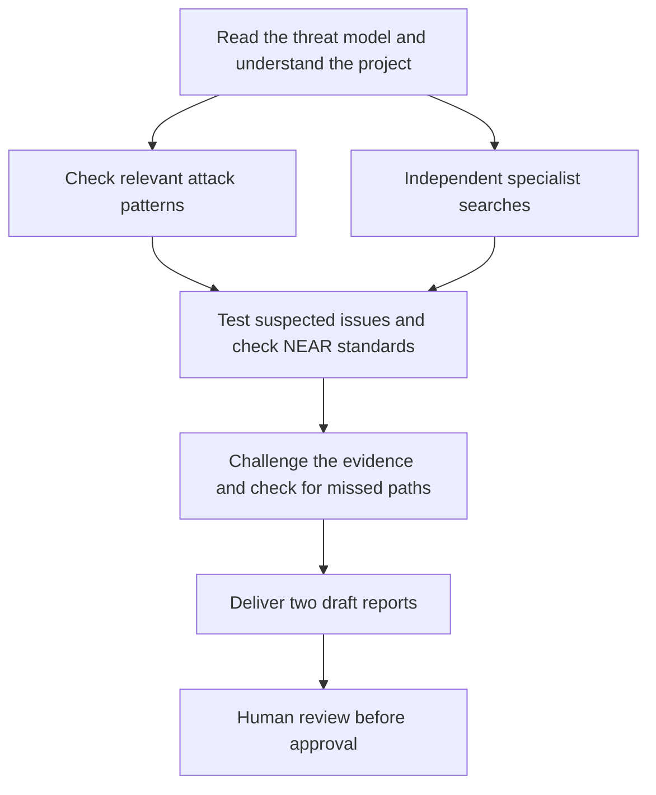

<div align="center">

```text
  +--------------------------------------------------+
  |                                                  |
  |                 SLOT ZERO SECURITY               |
  |                                                  |
  |                  NEARShield v1                    |
  |           Look closer. Follow the evidence.       |
  |                                                  |
  +--------------------------------------------------+
```

# NEARShield v1

**Slot Zero Security Framework for NEAR Code Review**

<p>
  <a href="https://slotzerosecurity.com/"></a>
  <a href="https://slotzerosecurity.com/contact"></a>
  <a href="https://github.com/SlotZeroSecurity/audits"></a>
  <a href="https://x.com/Slot_Zero_Sec"></a>
</p>

[Install](#install) · [Run a review](#run-a-review) · [How it works](#how-it-works) · [Patterns](#pattern-library) · [Reports](#what-you-receive)

</div>

NEARShield reviews NEAR contracts and the services that interact with them for security problems.
Independent specialist agents examine different parts of the system, then challenge suspected issues against the code and evidence.

**96 patterns · 10 categories · independent review · 2 Markdown reports**

## Install

Use the same setup flow in Codex, Claude Code, or OpenCode.
You need Git, Python 3.10+, macOS or Linux, and access to this repository.

**1. Clone the complete skill.**

```bash
git clone --branch v1 --single-branch \
  https://github.com/SlotZeroSecurity/slotzero-nearshield.git \
  nearshield-v1
```

**2. Open your AI tool in the folder containing the clone and ask:**

```text
Install the complete ./nearshield-v1 folder as a personal skill for this AI tool.
Use this tool's supported skills directory and keep all supporting files.
If nearshield-v1 is already installed, keep the existing copy and tell me its path.
```

Start a new session after installation. Copy the whole package, not just `SKILL.md`.
The destination depends on your AI tool; the setup request stays the same.
Codex is the intended host. Full execution on Claude Code and OpenCode remains unverified.
See the [usage guide](docs/usage.md#installation-alternatives) for manual paths and prerequisites.

## Run a review

Paste these into your AI conversation after preparing the [threat model](#threat-model).
They are prompts, not terminal commands. The host needs tools for running the required specialist agents.

**Run one discovery pass**

```text
$nearshield-v1 Audit /absolute/path/to/near-project with --loop 1.
Read THREAT_MODEL.md first and keep audit files outside the project.
```

**Run five independent discovery passes**

```text
$nearshield-v1 Audit /absolute/path/to/near-project --loop 5.
Read THREAT_MODEL.md first and keep audit files outside the project.
```

**Focus on selected files**

```text
$nearshield-v1 Audit /absolute/path/to/near-project with --loop 1.
Focus on contracts/vault/src/lib.rs and contracts/vault/src/fees.rs.
Read THREAT_MODEL.md first and inspect surrounding code where needed.
Keep audit files outside the project.
```

In Claude Code, replace `$nearshield-v1` with `/nearshield-v1`.
In OpenCode, begin with **“Load the nearshield-v1 skill”** and give the same request.

`--loop 1` asks for one independent discovery pass; `--loop` means three.
Choose `--loop N` for **1–10 passes**. Extra passes repeat the independent search, not the whole review.
Every review includes specialist applicability checks, all applicable mutation operators, independent verification, and a final rescan.
See [all options](docs/usage.md#scope-and-discovery-passes) when you need more control.

## Threat model

Put `THREAT_MODEL.md` in the root of the project being reviewed.
Describe **what needs protecting, what an attacker can do, who is trusted, and which rules must always hold**.
Every agent reads it first. An explicitly trusted owner's intended powers are not automatically bugs; unauthorized access still matters.

If the file is missing, generate it with the [Codex Security threat-model skill](https://github.com/openai/codex-security/tree/main/plugins/codex-security/skills/threat-model), review it, and restart the scan.
Continuing without one requires your explicit choice. See the [example and details](docs/usage.md#threat-model).

## How it works



One coordinating agent organizes the review. Specialists search independently without seeing each other's findings during discovery.
Testing and verification separate supported findings from ideas that still need evidence.
The reports show what was reviewed, what was found, and what remains uncertain.

## Meet the specialists

| Team | What they look for |
| --- | --- |
| Access control | Can the wrong person call a protected action or gain extra powers? |
| Asynchronous calls | What happens when a later call fails, arrives late, or runs twice? |
| Accounting | Do deposits, balances, shares, and refunds add up? |
| State and upgrades | Do stored records stay consistent as actions and upgrades happen? |
| Economics and math | Can rounding, prices, or incentives give someone an unfair advantage? |
| Resource limits | Can expensive work or storage costs block other users? |
| Integrations | Are prices, bridges, signatures, and services trusted correctly? |
| NEAR standards | Do token, wallet, and contract behaviors follow the relevant rules? |
| Independent verification | Does the suspected attack really work, and what evidence is missing? |

Additional specialists join when the project uses features such as bridges, price feeds, or upgradeable contracts.
The host schedules agents within its available capacity; they do not all need to run at once.
Explore the [full agent catalog](runtime/workflow/agent-catalog.md) for the individual roles.

## Pattern library

**96 patterns across 10 categories.** Each is a way to ask better questions about the code—not proof that a bug exists.

| Category | Patterns | Example question |
| --- | ---: | --- |
| [Access control](references/auth.md) | 12 | Can someone act with another account's authority? |
| [Asynchronous execution](references/async.md) | 17 | Can a delayed callback pay the same balance twice? |
| [Accounting](references/account.md) | 7 | Can newly issued shares dilute existing deposits? |
| [State](references/state.md) | 16 | Can two records disagree after an update? |
| [Economics](references/econ.md) | 4 | Can repeated rounding give someone extra value? |
| [Resources](references/resource.md) | 10 | Can a caller make the contract pay excessive storage costs? |
| [Integrations](references/integration.md) | 8 | Can an old price be used as if it were current? |
| [Cryptography](references/crypto.md) | 8 | Can a signature be accepted in the wrong context? |
| [Runtime](references/runtime.md) | 2 | Can work escape its intended execution limits? |
| [Offchain services](references/offchain.md) | 12 | Can a retry cause an external service to repeat an action? |
| **Total** | **96** | |

Relevant NEAR standards and reviewed documentation support these checks.
A finding still needs evidence from the actual project.

## What you receive

Every completed scan provides two downloadable Markdown files automatically:

| File | What's inside |
| --- | --- |
| `slotzero-report.md` | The compact review: findings, evidence confidence, suggested fixes where supported, and unverified leads. |
| `technical-annex.md` | The full evidence: affected code, attack paths, tests, coverage, limitations, and review status. |

Confidence describes the strength of the evidence; severity describes the impact.
Reports remain **Draft** until the required human review is complete. No automated review proves a project has no vulnerabilities.

## Resources

[Detailed usage guide](docs/usage.md) · [Report format](runtime/reporting/slotzero-report-format.md) · [Add patterns](docs/adding-patterns.md) · [Maintenance](docs/maintenance.md)

Host documentation: [Codex](https://learn.chatgpt.com/docs/build-skills) · [Claude Code](https://code.claude.com/docs/en/skills) · [OpenCode skills](https://opencode.ai/docs/skills/) · [OpenCode agents](https://opencode.ai/docs/agents/).

Health checks allow installation links in this README and remain offline and read-only. See [troubleshooting](docs/usage.md#maintenance-and-troubleshooting).

Licensed under [MIT](LICENSE). Existing third-party notices remain applicable. The focused-lens organization was informed by [0xsimao/0xsimao-ai](https://github.com/0xsimao/0xsimao-ai); the public layout also draws architectural inspiration from [sanbir/solana-auditor-skills](https://github.com/sanbir/solana-auditor-skills). NEAR guidance is maintained locally; official standards and documentation pins remain in the runtime registries.

## Package layout

- `references/`: ten category files, the routing index, and target-binding guidance.
- `runtime/`: workflow instructions, schemas, reviewed standards, and report templates.
- `docs/`: usage, package maintenance, and pattern intake.
- `scripts/`, `agents/`, `tests/`, `benchmarks/`: controller/helpers, host metadata, regression coverage, and qualification inputs.

To add knowledge, supply a PDF, report, or findings and ask the skill to compare
its mechanisms with the existing patterns. Covered mechanisms need no edit;
useful variants improve an existing card; distinct mechanisms get a permanent ID
in the best-fitting category. No report archive or consumed-file registry is kept.
See [adding patterns](docs/adding-patterns.md).

The installation command selects the published `v1` release branch.
For local installation, use the complete package or extracted release archive.
Existing runs require the package that created them. The skill name and report
formats remain `nearshield-v1`.
