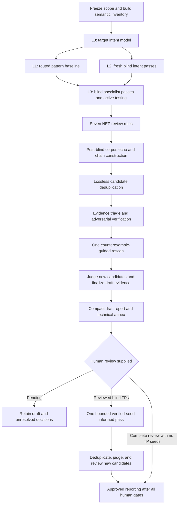

# NEARShield V1

**An AI-powered, multi-agent security audit framework for NEAR smart contracts and protocol integrations.**

<p>
  <a href="https://slotzerosecurity.com/"></a>
  <a href="https://slotzerosecurity.com/contact"></a>
  <a href="https://github.com/SlotZeroSecurity/audits"></a>
  <a href="https://x.com/Slot_Zero_Sec"></a>
</p>

NEARShield combines target modeling, NEAR-specific attack patterns, independent discovery agents, active testing, NEP conformance review, and adversarial verification. It produces a concise security report backed by a full technical evidence annex.

**Version:** V1 · **Skill name:** `near-auditor` · **Controller:** `scripts/near_audit.py`

The AI host orchestrates the audit and dispatches workers. The Python controller prepares work packets, tracks evidence, and validates phase gates; running it alone does not perform an AI audit.

## Contents

- [Quick start](#quick-start)
- [Installation](#installation)
- [Modes and discovery passes](#modes-and-discovery-passes)
- [Usage examples](#usage-examples)
- [Architecture](#architecture)
- [Pattern library and coverage](#pattern-library-and-coverage)
- [Reports and evidence](#reports-and-evidence)
- [Controller reference](#controller-reference)
- [Maintenance and troubleshooting](#maintenance-and-troubleshooting)
- [Further reading](#further-reading)

## Quick start

1. Install the complete skill using the instructions for your host below.
2. Start a new host session in the NEAR repository you want reviewed.
3. Invoke `near-auditor` with an explicit target, mode, and discovery-pass count.

For Codex, paste this into the conversation after installation:

```text
$near-auditor Audit /absolute/path/to/near-project in standard mode with --loop 3.
Keep audit artifacts outside the target repository and deliver the draft report
with its technical annex. Use the available subagents for the required roles.
```

Replace example paths with your own paths. The skill preserves audited source and uses a separate run directory. A complete multi-agent audit requires a host with worker execution; a serial review must be identified as incomplete coverage.

## Installation

### Requirements

- macOS or Linux and Python **3.10+**. Runtime helpers use the Python standard library.
- Git and access to this repository. The repository is currently private; authenticate with an account that has access before cloning.
- An installed and authenticated AI host with shell/file tools and subagent capabilities for complete audits.
- Target-specific toolchains, such as Rust/Cargo, where compilation or executable verification requires them. Missing tools are reported as blockers.
- PyYAML is optional for skill metadata validation, not a runtime requirement.

Install the whole repository, including `scripts/`, `references/`, `agents/`, `tests/`, and `benchmarks/`. Copying only `SKILL.md` leaves required resources missing. Use a fresh destination; do not overwrite another installation that existing runs depend on.

### Codex

Personal installation, available across projects:

```bash
mkdir -p "$HOME/.agents/skills"
git clone https://github.com/SlotZeroSecurity/slotzero-nearshield.git \
  "$HOME/.agents/skills/near-auditor"
```

For a project installation, run from the project root instead:

```bash
mkdir -p .agents/skills
git clone https://github.com/SlotZeroSecurity/slotzero-nearshield.git \
  .agents/skills/near-auditor
```

Start a new Codex session and select or invoke **`$near-auditor`**. These examples use the currently documented skill locations; existing installations may use a different configured path. See [Codex skill documentation](https://learn.chatgpt.com/docs/build-skills).

### Claude Code

Personal installation:

```bash
mkdir -p "$HOME/.claude/skills"
git clone https://github.com/SlotZeroSecurity/slotzero-nearshield.git \
  "$HOME/.claude/skills/near-auditor"
```

For a project installation, run from the project root instead:

```bash
mkdir -p .claude/skills
git clone https://github.com/SlotZeroSecurity/slotzero-nearshield.git \
  .claude/skills/near-auditor
```

Invoke the skill in a local Claude Code session:

```text
/near-auditor Audit /absolute/path/to/near-project in standard mode with --loop 3.
Use the available subagents and report any unsupported orchestration requirement.
```

See [Claude Code skills](https://code.claude.com/docs/en/skills) for skill loading and slash-command behavior. Personal local skills are not automatically available in every cloud session.

### OpenCode

Personal installation:

```bash
mkdir -p "$HOME/.config/opencode/skills"
git clone https://github.com/SlotZeroSecurity/slotzero-nearshield.git \
  "$HOME/.config/opencode/skills/near-auditor"
```

For a project installation, run from the project root instead:

```bash
mkdir -p .opencode/skills
git clone https://github.com/SlotZeroSecurity/slotzero-nearshield.git \
  .opencode/skills/near-auditor
```

Ask OpenCode to load the skill explicitly:

```text
Load the near-auditor skill and audit /absolute/path/to/near-project in standard
mode with 3 discovery passes. Use available subagents for the required roles
and report any unsupported orchestration requirement.
```

See [OpenCode skills](https://opencode.ai/docs/skills/) and [OpenCode agents](https://opencode.ai/docs/agents/). A custom `/near-auditor` command is not required by these instructions.

### Host compatibility and preflight

V1's orchestration instructions and worker adapter target **Codex**. Claude Code and OpenCode can discover the skill through their documented skill directories, but full NEARShield multi-agent execution on those hosts has **not been validated here**. Loading a skill does not prove worker isolation, role coverage, cancellation, or end-to-end compatibility. `agents/openai.yaml` supplies Codex metadata, not Claude/OpenCode agent configuration.

From the installed skill directory, inspect the package before starting an audit:

```bash
python3 scripts/near_audit.py doctor
python3 scripts/maintain.py check
```

**Known V1 documentation packaging issue:** both checks currently scan all Markdown for external URLs, including this README. With this README present, they report its badge and reference URLs as a package error. This documentation change does not modify those validators. See [troubleshooting](#maintenance-and-troubleshooting); do not treat a reported failure as a passed preflight.

## Modes and discovery passes

Mode determines scope and testing effort. Discovery passes determine how many fresh blind L2/L3 searches are scheduled; these are independent settings.

| Option | Behavior |
| --- | --- |
| Standard | Default mode. Review relevant source, preserve required roles and coverage, and sample each applicable mutation family. |
| Explicit files | Named files are primary scope; inspect surrounding code and dependencies needed to validate them. |
| Deep | Include uncertain conditional roles, all applicable mutations, fresh corpus/chain agents, verification across all severities, and a final exclusion-list rescan with no new Medium+ findings. |
| `--loop 1` | One blind discovery pass, without prior-pass context. |
| `--loop` | Three blind discovery passes. |
| `--loop N` | An explicit integer from **1 to 10**; natural-language counts are also accepted by the workflow. |
| No pass count | Ask for a count before expensive audit work. The CLI prompts interactively; noninteractive use without a count fails. |
| Request-level `--file-output` | Request an additional compact-report copy at an explicitly named destination outside audited source. The normal reports are already retained in the run directory. |

Loops repeat **blind L2 intent reasoning and blind L3 specialist discovery**, with fresh contexts and no prior findings disclosed. They do not repeat L0, the L1 baseline, active testing, NEP review, the counterexample rescan, or the human-informed rescan. Repeated sightings do not raise confidence automatically.

**Prompt syntax and Python syntax differ:** `--deep` and `--file-output` are AI request options. The controller accepts `--mode deep`; it has no `--deep` or `--file-output` flag. `--loop` exists in both interfaces. L0–L4 describe demonstrated capabilities, not scan modes.

## Usage examples

These examples are **messages to the AI host**, not shell commands. For Claude Code replace `$near-auditor` with `/near-auditor`; for OpenCode start with “Load the near-auditor skill.”

### Standard audit with one pass

```text
$near-auditor Audit /absolute/path/to/near-project in standard mode with --loop 1.
Deliver the compact draft report and full technical annex.
```

### Standard audit with three passes

```text
$near-auditor Audit /absolute/path/to/near-project in standard mode with --loop 3.
Keep the discovery contexts independent and account for all required coverage.
```

### Deep audit with five passes

```text
$near-auditor Audit /absolute/path/to/near-project --deep --loop 5.
Run the applicable deep-mode gates and report any verification blockers.
```

### Audit selected files

```text
$near-auditor Audit /absolute/path/to/near-project with --loop 1.
Use explicit-file scope: contracts/vault/src/lib.rs and contracts/vault/src/fees.rs.
Read the surrounding context needed to establish reachability and impact.
```

### Copy the compact report to another location

```text
$near-auditor Audit /absolute/path/to/near-project in standard mode with --loop 3
and --file-output. Copy the compact report to /absolute/path/to/reviews/nearshield.md,
outside the audited repository. Retain the complete run artifacts and annex.
```

Generated build output, vendored dependencies, and unrelated crates are excluded from primary scope. Tests and examples provide verification context. Adjacent TypeScript, JavaScript, or Solidity is included when it affects signing, relaying, bridging, indexing, settlement, or user security. The workflow stops if no NEAR surface is found.

## Architecture



### Components

| Component | Responsibility |
| --- | --- |
| AI orchestrator | Load the workflow, resolve target/scope, dispatch independent workers, collect outputs, enforce phase order, and deliver reports. |
| Python controller | Freeze source/configuration bindings, create work packets, validate run state and evidence, and record worker events. It does not spawn workers. |
| Specialist agents | Execute assigned role packets and write their candidate/coverage artifacts; discovery workers do not judge or deduplicate peer results. |
| Reference library | Supply routed NEAR attack lenses, pinned NEP checklists, official guidance, schemas, and historical provenance. |
| Validators and renderers | Check candidate accounting and coverage, preserve evidence, and render technical and reader-facing reports. |

### Capability levels and isolation

| Level | Meaning |
| --- | --- |
| L0 | Recover target intent, actors, assets, invariants, and receipt state machines. Emits a model, not findings. |
| L1 | Match target behavior to known NEAR mechanisms using only routed pattern categories. |
| L2 | Independently reason about intended versus actual behavior without the attack corpus or peer findings. |
| L3 | Coordinate specialist discovery, active testing, and adversarial judging. |
| L4 | Demonstrate performance on an isolated, adjudicated benchmark track; V1 architecture alone does not establish this level. |

L0/L2 receive neutral target context. Blind workers cannot read peer or prior-pass findings; corpus echo happens only after blind discovery is frozen. Packet restrictions are **prompt-only** unless the host supplies evidence of enforced isolation.

The controller maintains a hash-linked append-only journal in `run-events/`. `run-state.json` is its recoverable projection. V1 uses manifest schema 6 and state schema 4; `status` is read-only, while `resume` can repair the projection and advance validated phases. Configuration or source drift blocks continuation under the original bindings.

### Roles and active methods

- **12 core discovery roles:** `entrypoints-auth`, `async-promises`, `state-storage`, `token-accounting`, `math-economics`, `gas-dos`, `invariant-flow`, `periphery-build`, `coverage-sweep`, `numerical-gap`, `trust-gap`, and `flow-gap`.
- **Conditional roles:** `upgrade-keys`, `intents-auth`, `bridge-relayer`, `chain-signatures-yield`, `runtime-consensus`, and `oracle-freshness`, selected from the target surface; deep mode also includes uncertain applicability.
- **Active testing:** invariant synthesis, mutation analysis, and applicable async schedule exploration, NEP differential tests, and temporal/upgrade analysis.
- **NEP roles:** process/legacy, token assets, contract interfaces, wallet/auth, runtime resources, crypto/host, and protocol/node.
- **Verification and rescans:** evidence triage, fresh adversarial verifiers, an additional independent skeptic for High/Critical candidates, one counterexample-guided rescan, and one later human-informed verified-seed pass.

Each callable needs two independent lenses. Value-bearing receipt chains require async, accounting, seam analysis, and applicable async state exploration. Role count is not the number of simultaneously running agents: the orchestrator schedules workers within observed host capacity. See the [agent catalog](references/agent-catalog.md) and [capability model](references/capability-model.md).

## Pattern library and coverage

V1 includes **96 attack-lens patterns across 10 categories**. The [routing index](references/attack-lenses-index.json) selects relevant categories rather than loading the complete corpus into every worker.

| Category | Patterns | Representative mechanisms |
| --- | ---: | --- |
| [Authorization](references/attack-lenses/auth.md) | 12 | Signer/predecessor confusion, exposed privileged methods, replay, access-key boundaries. |
| [Async execution](references/attack-lenses/async.md) | 17 | Split-receipt double spends, missing compensation, stale callbacks, pending-state recovery. |
| [Accounting](references/attack-lenses/account.md) | 7 | Liabilities and reserves, storage attribution, claim recovery, vault-share dilution. |
| [State](references/attack-lenses/state.md) | 16 | Coupled-state divergence, migrations, lifecycle transitions, configuration combinations. |
| [Economics](references/attack-lenses/econ.md) | 4 | Asset/unit confusion, rounding and overflow, ordering or reward manipulation. |
| [Resources](references/attack-lenses/resource.md) | 10 | Underpriced storage, prefix collisions, unbounded work, sponsorship and refunds. |
| [Integration](references/attack-lenses/integration.md) | 8 | Receiver identity, ABI drift, proof/finality races, oracle freshness. |
| [Cryptography](references/attack-lenses/crypto.md) | 8 | Canonical decoding, threshold binding, nonce reuse, secrets, attestations. |
| [Runtime](references/attack-lenses/runtime.md) | 2 | Unmetered host work and consensus agreement/liveness. |
| [Offchain](references/attack-lenses/offchain.md) | 12 | Indexer trust, relayer retries, unsafe inputs, build/release integrity, recovery documentation. |
| **Total** | **96** | |

Cards use stable identifiers such as `NA-AUTH-001` and `NA-ASYNC-002`. Historical resemblance is a search aid: findings require a reachable target-specific attack, a broken invariant, and material harm. Quality-only cards stay advisories unless concrete security impact is established. See the [pattern-binding protocol](references/pattern-portability.md).

The bundled registries contain **51 NEP records** and **197 official-documentation records**, pinned to reviewed source revisions. These are inventory counts, not a promise that every item applies to every target or that upstream sources are current. Final/Approved NEPs are normative only when applicable and active; Draft/New material is advisory. Coverage records include evidence-backed exclusions. See the [NEP registry](references/nep-registry.json), [documentation registry](references/official-docs-registry.json), and [provenance](references/provenance.md).

## Reports and evidence

The default deliverable is a **draft**. Human review is required before findings and conformance deviations enter an approved report. Pending human feedback does not prevent delivery of the completed automated draft.

| Artifact | Purpose |
| --- | --- |
| `pashov-report.md` | Compact reader-facing security review, retained in the run directory and delivered in the conversation according to renderer output rules. |
| `draft-report.md` | Full technical annex: finalized evidence, receipt traces, scope, proof, limitations, and dispositions. |
| `run-manifest.json`, `run-events/`, `run-state.json` | Frozen inputs/configuration, event history, worker observations, and phase progress. |
| `surface.json`, `semantic-ir.json`, `intent-model.json` | Target inventory, navigation graph, and grounded intent model. |
| Candidate and disposition JSONL ledgers | Raw discoveries, deduplication, verdicts, rejected/blocked candidates, and complete accounting. |
| NEP, official-guidance, and active-test ledgers | Standards coverage, routed guidance, schedules, invariants, mutations, and applicable differential/upgrade evidence. |

Severity and confidence are separate. Repeated discoveries do not prove correctness. Draft reports and benchmark smoke fixtures do not certify deployment safety or establish L4 qualification. See the [compact report format](references/pashov-report-format.md) and [verification/reporting rules](references/verification-reporting.md).

## Controller reference

The recommended entry point is the **AI-host prompt**. The commands below support an orchestrator or a maintainer inspecting a run. They do not replace worker execution or automatically produce the evidence required to finalize a report.

<details>
<summary><strong>Expand all controller commands, flags, and examples</strong></summary>

### Paths and initialization

Set these paths in your shell before using the examples. Use a fresh, empty run directory outside the target. The installed skill path depends on your host.

```bash
NEARSHIELD_SKILL="/absolute/path/to/near-auditor"
NEARSHIELD_TARGET="/absolute/path/to/near-project"
NEARSHIELD_RUN="/absolute/path/to/audit-runs/near-project-v1"

python3 "$NEARSHIELD_SKILL/scripts/near_audit.py" doctor
python3 "$NEARSHIELD_SKILL/scripts/near_audit.py" run "$NEARSHIELD_TARGET" \
  --mode standard --loop 3 --run-dir "$NEARSHIELD_RUN" --worker-capacity 1
```

| `run` argument | Meaning and default |
| --- | --- |
| `target` | Required target directory. |
| `--mode standard\|explicit-files\|deep` | Default `standard`. Use `--mode deep` for deep initialization. |
| `--files PATH [PATH ...]` | Explicit scope paths, resolved against the target; default empty. Required for `--mode explicit-files`. |
| `--loop [N]` | Integer 1–10; bare flag selects 3. Omission prompts interactively or fails without an interactive terminal. |
| `--run-dir PATH` | Fresh directory outside source; omission creates a temporary `near-audit-*` directory. |
| `--worker-capacity N` | Requested positive spawned-worker count, excluding the orchestrator; parser default 8. The example uses 1 without assuming host capacity. |
| `--runtime-capacity N` | Observed positive host worker capacity; unknown by default. Requested capacity cannot exceed it. Unknown runtime capacity permits only one recorded active worker. |
| `--orchestrator-model NAME` | Record an observed orchestrator model identifier; unknown by default. Does not select or launch a model. |
| `--worker-model NAME` | Record an observed worker model identifier; unknown by default. Does not configure host workers. |

Alternative initializations, **choose one for a fresh run directory**:

```bash
python3 "$NEARSHIELD_SKILL/scripts/near_audit.py" run "$NEARSHIELD_TARGET" \
  --mode deep --loop 5 --run-dir "$NEARSHIELD_RUN" --worker-capacity 1

python3 "$NEARSHIELD_SKILL/scripts/near_audit.py" run "$NEARSHIELD_TARGET" \
  --mode explicit-files --files contracts/vault/src/lib.rs contracts/vault/src/fees.rs \
  --loop 1 --run-dir "$NEARSHIELD_RUN" --worker-capacity 1
```

### Command inventory

All commands support `-h` / `--help`. Paths shown below are positional unless prefixed with `--`.

| Command | Arguments and behavior |
| --- | --- |
| `doctor` | No additional arguments. Read-only package and prerequisite inspection. |
| `run` | `target` plus the flags above. Initialize a frozen run and work packets. |
| `status` | `run_dir`. Read-only journal-derived progress. |
| `resume` | `run_dir`. Validate bindings, repair a stale/missing state projection, and advance when phase gates pass. Does not dispatch workers. |
| `packet` | `run_dir packet_id`. Inspect one minimal role packet; take its ID from the run's work packets. |
| `worker` | `run_dir start\|finish\|fail\|cancel packet_id` plus worker flags below. Record observed host events. |
| `feedback` | `run_dir labels`. Import actual human labels from a JSONL file. |
| `informed-rescan` | `run_dir [--complete]`. Prepare the single human-informed pass or validate its completion. |
| `render-report` | `run_dir --body PATH --output PATH [--stage draft\|approved]`. Render the technical annex; stage defaults to `draft`. |
| `finalize` | `run_dir --report PATH [--stage draft\|approved]`. Validate evidence and finalize the technical report; stage defaults to `draft`. |

### Worker event flags

| Flag | Meaning |
| --- | --- |
| `--worker-id ID` | Actual host worker ID; required for `start`, checked against the recorded identity when supplied later. |
| `--isolation prompt_only\|host_enforced` | Default `prompt_only`; enforced isolation requires host evidence. |
| `--isolation-evidence TEXT` | Observed evidence required for `host_enforced` at start. |
| `--termination-evidence TEXT` | Host-confirmed termination evidence for cancellation; a cancellation request alone is not proof of termination. |
| `--reason TEXT` | Failure or cancellation explanation. |
| `--wall-seconds NUMBER` | Observed elapsed wall time; unknown when omitted. |
| `--input-tokens INTEGER` | Observed input-token count; unknown when omitted. |
| `--output-tokens INTEGER` | Observed output-token count; unknown when omitted. |

Only record events that actually happened. `finish` checks assigned output existence, containment, size, and JSON/JSONL syntax; phase gates still decide full schema and coverage acceptance. The adapter neither spawns nor terminates host workers.

```bash
python3 "$NEARSHIELD_SKILL/scripts/near_audit.py" status "$NEARSHIELD_RUN"
python3 "$NEARSHIELD_SKILL/scripts/near_audit.py" packet "$NEARSHIELD_RUN" 'packet-id-from-work-packets'
python3 "$NEARSHIELD_SKILL/scripts/near_audit.py" worker "$NEARSHIELD_RUN" start \
  'packet-id-from-work-packets' --worker-id 'actual-host-worker-id'
# After the real worker completes and its assigned artifacts have been collected:
python3 "$NEARSHIELD_SKILL/scripts/near_audit.py" worker "$NEARSHIELD_RUN" finish \
  'packet-id-from-work-packets' --worker-id 'actual-host-worker-id'
python3 "$NEARSHIELD_SKILL/scripts/near_audit.py" resume "$NEARSHIELD_RUN"
```

### Feedback and report lifecycle

Human labels use `TP`, `FP`, `DUPLICATE`, or `UNRESOLVED`, with reviewer, review time, and reason code. Follow the complete [feedback and verdict schemas](references/finding-schema.md). Feedback is metrics-only: it does not silently retrain or modify the corpus. Only manually labeled blind TPs seed the one bounded informed pass.

```bash
python3 "$NEARSHIELD_SKILL/scripts/near_audit.py" feedback "$NEARSHIELD_RUN" \
  /absolute/path/to/human-labels.jsonl
python3 "$NEARSHIELD_SKILL/scripts/near_audit.py" informed-rescan "$NEARSHIELD_RUN"
# After the orchestrator completes the assigned informed work and review:
python3 "$NEARSHIELD_SKILL/scripts/near_audit.py" informed-rescan "$NEARSHIELD_RUN" --complete
```

The orchestrator must first produce the validated ledgers and technical body. Reporting then uses:

```bash
python3 "$NEARSHIELD_SKILL/scripts/near_audit.py" render-report "$NEARSHIELD_RUN" \
  --body "$NEARSHIELD_RUN/report-body.md" --output "$NEARSHIELD_RUN/draft-report.md" --stage draft
python3 "$NEARSHIELD_SKILL/scripts/near_audit.py" finalize "$NEARSHIELD_RUN" \
  --report "$NEARSHIELD_RUN/draft-report.md" --stage draft
# Prepare source-backed presentation rows using the compact report schema first:
python3 "$NEARSHIELD_SKILL/scripts/render_pashov_report.py" "$NEARSHIELD_RUN" \
  --content "$NEARSHIELD_RUN/pashov-content.jsonl" --output "$NEARSHIELD_RUN/pashov-report.md"
```

Keep report artifacts inside the run directory. An AI-requested `--file-output` copy is a separate delivery action outside audited source. For approved delivery, use separate approved report outputs and `--stage approved` only after the human gates pass; do not relabel a draft as approved.

</details>

## Maintenance and troubleshooting

Maintenance, corpus ingestion, standards refresh, and benchmark qualification are separate request routes; they do not start a target audit. Use the [maintenance guide](references/maintenance.md) for helper interfaces and explicit input requirements.

| Symptom | Action |
| --- | --- |
| Skill is not discovered | Confirm the directory is named `near-auditor`, contains `SKILL.md` and supporting folders, and sits in a documented host skill location. Start a new session and check host permissions. |
| Clone returns “not found” | Confirm the authenticated account has access to this private repository. |
| Preflight reports an external URL in `README.md` | Known V1 packaging conflict: both `doctor` and `maintain.py check` scan every Markdown file, including public-facing badge/reference links. This README is intentionally retained; the validator policy needs a separate code change before whole-checkout checks can pass. Other errors require independent investigation. |
| Worker execution is unavailable | Report incomplete multi-agent coverage; do not describe serial review as a complete run. Claude Code/OpenCode end-to-end compatibility remains unverified. |
| Discovery-pass count is unspecified | Supply `--loop 1`, bare `--loop`, or `--loop N` with N between 1 and 10. |
| Run directory is rejected | Choose a fresh empty directory outside the target source tree. |
| Configuration/source bindings changed | Preserve the original configuration for existing runs or restart in a fresh run directory; do not rewrite saved hashes. |
| Older run schema cannot resume | Inspect read-only and restart under the current schema. |
| Worker is marked submitted but phase cannot advance | Check full candidate schemas, required empty result files, coverage ledgers, and unresolved worker failures. Syntax success alone is insufficient. |
| PyYAML is unavailable | Optional metadata validation is unavailable; record that limitation. Standard-library runtime helpers do not require installing it. |

Qualification helpers live under `maintain.py qualification`; corpus and standards operations use `maintain.py corpus` and `maintain.py standards`. Each operation forwards to a dedicated helper with its own `--help`. Public fixtures are regression examples, not evidence of production detection rates or a benchmark qualification claim.

## Further reading

- [Skill entry point](SKILL.md) and [complete audit workflow](references/audit-workflow.md)
- [Agent catalog](references/agent-catalog.md), [capability model](references/capability-model.md), and [semantic pipeline](references/semantic-pipeline.md)
- [Run journal and worker adapter](references/runtime-adapter.md)
- [Attack-lens routing index](references/attack-lenses-index.json) and [NEAR security model](references/near-security-model.md)
- [Finding schema](references/finding-schema.md), [technical annex template](references/report-template.md), and [compact report format](references/pashov-report-format.md)
- [Maintenance](references/maintenance.md) and [source provenance](references/provenance.md)

For professional review, [request an audit from Slot Zero Security](https://slotzerosecurity.com/contact). Explore [public audit reports](https://github.com/SlotZeroSecurity/audits) and follow [Slot Zero Security on X](https://x.com/Slot_Zero_Sec).
