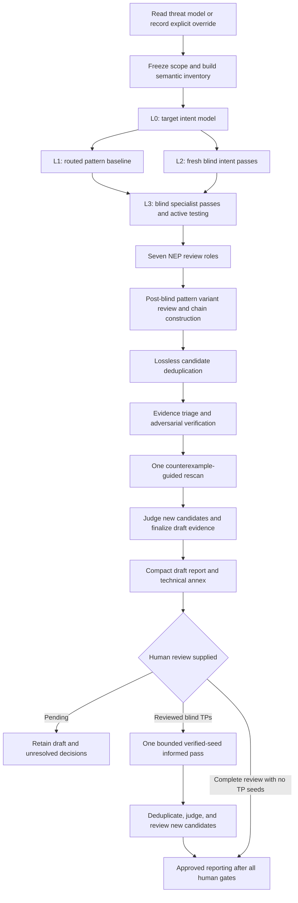

# NEARShield v1 usage guide

[Back to the overview](../README.md)

Detailed setup, options, reporting rules, and maintenance reference. Start with
[installation and examples](../README.md#install) for the short version.

## Installation alternatives

Install the complete package, not just `SKILL.md`. Use the shared clone command
in the README, then copy the complete folder to the appropriate path below
if installing manually.
Use branch `v1`, or the complete extracted release archive,
and a fresh destination; do not overwrite an installation needed
by an existing run. Restart your AI host after installing.

| Host | Personal destination | Project destination (from project root) |
| --- | --- | --- |
| Codex | `~/.agents/skills/nearshield-v1` | `.agents/skills/nearshield-v1` |
| Claude Code | `~/.claude/skills/nearshield-v1` | `.claude/skills/nearshield-v1` |
| OpenCode | `~/.config/opencode/skills/nearshield-v1` | `.opencode/skills/nearshield-v1` |

Existing Codex installations can also use their configured skills directory,
including `~/.codex/skills/nearshield-v1`. Do not install duplicate copies in
multiple discovery locations. Host documentation is linked in the
[README resources](../README.md#resources).

Use macOS or Linux, Python 3.10+, Git, and an authenticated AI host with shell,
file, and worker tools. Target testing may need Rust/Cargo or other toolchains.
Missing tools are reported as blockers. PyYAML is optional for metadata checks.
Codex is the intended host; full execution on Claude Code and OpenCode remains
unverified. Skill loading alone does not establish complete audit compatibility.

Run these read-only checks from the installed package directory:

```bash
python3 scripts/near_audit.py doctor
python3 scripts/maintain.py check
```

Both checks allow web links in the package's top-level README and reject them
elsewhere. They validate the local package without fetching upstream sources.
Inspect any reported errors; no dependencies need to be installed for these checks.

## Guide contents

- [Threat model](usage.md#threat-model)
- [Scope and discovery passes](usage.md#scope-and-discovery-passes)
- [Usage examples](usage.md#usage-examples)
- [Architecture](usage.md#architecture)
- [Pattern library and coverage](usage.md#pattern-library-and-coverage)
- [Reports and evidence](usage.md#reports-and-evidence)
- [Controller reference](usage.md#controller-reference)
- [Maintenance and troubleshooting](usage.md#maintenance-and-troubleshooting)

## Threat model

Every scan starts with **`<target-root>/THREAT_MODEL.md`**. Describe the assets,
attacker capabilities, trusted roles, and security properties for the actual
repository. Every audit agent reads this file first, including independent
verification and rescan workers. NEARShield records its digest and checks it
throughout the run. Changing, removing, or later adding it requires a fresh scan.

If the file is missing or empty, NEARShield stops and displays:

> Auditing without explicit assets, attacker capabilities, trusted roles, and
> security properties increases the likelihood of false positives and the effort
> needed to validate findings. Generate the threat model and restart the scan,
> or explicitly choose to continue without it.

Use the [OpenAI Codex Security threat-model skill](../README.md#threat-model)
to generate a repository-specific model. Use the complete skill/plugin with its
supporting references, not an isolated copy of its entry file. Explicitly request
this destination because the upstream skill may otherwise save a differently
named artifact:

```text
Use the threat-model skill to generate a threat model for /absolute/path/to/near-project.
Save it as /absolute/path/to/near-project/THREAT_MODEL.md. Identify assets,
attacker capabilities, trusted roles, and security properties from the actual
repository, and distinguish assumptions from established facts.
```

Review the result, then restart the NEARShield audit in a fresh run directory.
If that skill is unavailable, report that limitation; do not claim it ran or
substitute a generic model as if it were repository-specific.

### Explicit continuation without a model

You can explicitly tell the host to continue without the model for one scan.
The controller equivalent is `run ... --allow-missing-threat-model`. The host must
not supply this flag without your explicit choice; silence is not permission.
A valid existing model is always used, even with the flag. Unreadable files,
symlinks, and invalid UTF-8 are errors that the flag cannot bypass.

Overridden runs disclose inferred assumptions and the increased validation burden
in worker packets and reports. They cannot invent trusted-role assumptions to
exclude issues. The flag does not permanently disable the prerequisite.

### Example model

This is an **illustrative Vault model**, not a default set of assumptions for
NEAR. Adapt owner authority, oracle dependencies, transaction ordering, and flash
liquidity capabilities to the repository and execution environment.

```markdown
# Threat model

## Assets
- User deposits held by the Vault

## Trusted roles
- Owner (multisig): can pause and upgrade, assumed honest
- Chainlink price feeds: assumed honest but can be stale

## Attacker
- Any unprivileged address, can use flash loans and front-run

## Security properties
- A user can only withdraw what their shares are worth
- Nobody but the owner can pause or upgrade the protocol
```

### How findings are filtered

Triage and independent verification record a `threat_model_assessment` with the
model digest, exact model citations, attacker capabilities, trust assumptions,
and target-code evidence. Excluding a trusted-role attack requires checking
privilege escalation, authorization bypass, manipulation of the trusted actor,
and harm during honest operation.

| Candidate | Treatment under the example model |
| --- | --- |
| Honest owner deliberately upgrades to malicious code | Exclude when the attack depends entirely on violating the explicit honest-owner assumption and no alternate unprivileged path exists. |
| Unprivileged user bypasses the upgrade or pause guard | Retain for verification; owner trust does not cover unauthorized callers. |
| An attacker exploits a stale honest price feed | Retain for verification; staleness is explicitly allowed. |
| An honest admin action causes users to withdraw more than their share value | Retain for verification against the explicit property. |
| A trust boundary is ambiguous or absent from the model | Keep scope unresolved; do not silently exclude. |

Excluded issues are recorded as `out_of_scope`, not experimentally refuted or
false-positive exploits. They stay in the evidence ledger and a separate annex
accounting section, but are absent from findings, leads, recommendations, and
severity totals. Finalization and report rendering reject missing assessments,
stale digests, invalid citations, and excluded findings presented as reportable.
Citation validation establishes provenance; agents and human reviewers still
validate the meaning of the evidence. See the [assessment contract](../runtime/workflow/threat-model.md).

## Scope and discovery passes

Every scan follows [the comprehensive review contract](../runtime/workflow/review-contract.md): all
six specialist applicability reviews, all supported applicable mutation operators,
fresh follow-up agents, verification of every surviving candidate, and one bounded
rescan. Select files to focus scope; select passes to repeat independent discovery.

| Option | Behavior |
| --- | --- |
| Selected files | Named files are primary scope; inspect surrounding code needed to validate them. |
| `--loop 1` | One blind discovery pass without prior-pass context. |
| `--loop` | Three independent discovery passes. |
| `--loop N` | An explicit integer from 1 to 10. |
| No pass count | Ask before expensive work; the controller prompts interactively or fails noninteractively. |

Loops repeat blind intent reasoning and specialist discovery, not the entire
pipeline. They do not repeat modeling, the pattern baseline, active testing,
standards review, or the bounded rescans. Repeat sightings do not raise confidence.

## Usage examples

These examples are **messages to the AI host**, not shell commands. For Claude Code replace `$nearshield-v1` with `/nearshield-v1`; for OpenCode start with “Load the nearshield-v1 skill.”

### Audit with one pass

```text
$nearshield-v1 Audit /absolute/path/to/near-project with --loop 1.
Deliver the compact draft report and full technical annex.
```

### Audit with three passes

```text
$nearshield-v1 Audit /absolute/path/to/near-project with --loop 3.
Keep the discovery contexts independent and account for all required coverage.
```

### Audit with five passes

```text
$nearshield-v1 Audit /absolute/path/to/near-project --loop 5.
Run all required checks and report any verification blockers.
```

### Audit selected files

```text
$nearshield-v1 Audit /absolute/path/to/near-project with --loop 1.
Use explicit-file scope: contracts/vault/src/lib.rs and contracts/vault/src/fees.rs.
Read the surrounding context needed to establish reachability and impact.
```

### Automatic report delivery

Every completed automated audit delivers both `slotzero-report.md` and
`technical-annex.md`. No output option or extra request is needed. The final
response includes a clickable file link or attachment for each report.

Generated build output, vendored dependencies, and unrelated crates are excluded from primary scope. Tests and examples provide verification context. Adjacent TypeScript, JavaScript, or Solidity is included when it affects signing, relaying, bridging, indexing, settlement, or user security. The workflow stops if no NEAR surface is found.

## Architecture



### Components

| Component | Responsibility |
| --- | --- |
| AI orchestrator | Load the workflow, resolve target/scope, dispatch independent workers, collect outputs, enforce phase order, and deliver reports. |
| Python controller | Freeze source/configuration bindings, create work packets, validate run state and evidence, and record worker events. It does not spawn workers. |
| Specialist agents | Execute assigned role packets and write their candidate/coverage artifacts; discovery workers do not judge or deduplicate peer results. |
| Pattern library and runtime resources | Supply selected NEAR patterns, pinned NEP checklists, official guidance, schemas, and phase-specific instructions. |
| Validators and renderers | Check candidate accounting and coverage, preserve evidence, and render technical and reader-facing reports. |

### Capability levels and isolation

| Level | Meaning |
| --- | --- |
| L0 | Recover target intent, actors, assets, invariants, and receipt state machines. Emits a model, not findings. |
| L1 | Match target behavior to known NEAR mechanisms using only routed pattern categories. |
| L2 | Independently reason about intended versus actual behavior without the attack corpus or peer findings. |
| L3 | Coordinate specialist discovery, active testing, and adversarial judging. |
| L4 | Demonstrate performance on an isolated, adjudicated benchmark track; V1 architecture alone does not establish this level. |

L0/L2 receive neutral target context. Blind workers cannot read peer or prior-pass findings; pattern variant review happens only after blind discovery is frozen. Packet restrictions are **prompt-only** unless the host supplies evidence of enforced isolation.

The controller maintains a hash-linked append-only journal in `run-events/`. `run-state.json` is its recoverable projection. V1 uses manifest schema 7 and state schema 4; `status` is read-only, while `resume` can repair the projection and advance validated phases. Configuration or source drift blocks continuation under the original bindings.

### Roles and active methods

- **12 core discovery roles:** `entrypoints-auth`, `async-promises`, `state-storage`, `token-accounting`, `math-economics`, `gas-dos`, `invariant-flow`, `periphery-build`, `coverage-sweep`, `numerical-gap`, `trust-gap`, and `flow-gap`.
- **Conditional roles:** `upgrade-keys`, `intents-auth`, `bridge-relayer`, `chain-signatures-yield`, `runtime-consensus`, and `oracle-freshness`, scheduled in every discovery pass; each records evidence-backed applicability and investigates uncertain surfaces.
- **Active testing:** invariant synthesis, mutation analysis, and applicable async schedule exploration, NEP differential tests, and temporal/upgrade analysis.
- **NEP roles:** process/legacy, token assets, contract interfaces, wallet/auth, runtime resources, crypto/host, and protocol/node.
- **Verification and rescans:** evidence triage, fresh adversarial verifiers, an additional independent skeptic for High/Critical candidates, one counterexample-guided rescan, and one later human-informed verified-seed pass.

Each callable needs two independent lenses. Value-bearing receipt chains require async, accounting, seam analysis, and applicable async state exploration. Role count is not the number of simultaneously running agents: the orchestrator schedules workers within observed host capacity. See the [agent catalog](../runtime/workflow/agent-catalog.md) and [capability model](../runtime/workflow/capability-model.md).

## Pattern library and coverage

V1 includes **96 attack-lens patterns across 10 categories**. The [routing index](../references/index.json) selects relevant categories rather than loading the complete corpus into every worker.

| Category | Patterns | Representative mechanisms |
| --- | ---: | --- |
| [Authorization](../references/auth.md) | 12 | Signer/predecessor confusion, exposed privileged methods, replay, access-key boundaries. |
| [Async execution](../references/async.md) | 17 | Split-receipt double spends, missing compensation, stale callbacks, pending-state recovery. |
| [Accounting](../references/account.md) | 7 | Liabilities and reserves, storage attribution, claim recovery, vault-share dilution. |
| [State](../references/state.md) | 16 | Coupled-state divergence, migrations, lifecycle transitions, configuration combinations. |
| [Economics](../references/econ.md) | 4 | Asset/unit confusion, rounding and overflow, ordering or reward manipulation. |
| [Resources](../references/resource.md) | 10 | Underpriced storage, prefix collisions, unbounded work, sponsorship and refunds. |
| [Integration](../references/integration.md) | 8 | Receiver identity, ABI drift, proof/finality races, oracle freshness. |
| [Cryptography](../references/crypto.md) | 8 | Canonical decoding, threshold binding, nonce reuse, secrets, attestations. |
| [Runtime](../references/runtime.md) | 2 | Unmetered host work and consensus agreement/liveness. |
| [Offchain](../references/offchain.md) | 12 | Indexer trust, relayer retries, unsafe inputs, build/release integrity, recovery documentation. |
| **Total** | **96** | |

Cards use stable identifiers such as `NA-AUTH-001` and `NA-ASYNC-002`. Historical resemblance is a search aid: findings require a reachable target-specific attack, a broken invariant, and material harm. Quality-only cards stay advisories unless concrete security impact is established. See the [pattern-binding protocol](../references/target-binding.md).

The bundled registries contain **51 NEP records** and **197 official-documentation records**, pinned to reviewed source revisions. These are inventory counts, not a promise that every item applies to every target or that upstream sources are current. Final/Approved NEPs are normative only when applicable and active; Draft/New material is advisory. Coverage records include evidence-backed exclusions. See the [NEP registry](../runtime/standards/neps/nep-registry.json), [documentation registry](../runtime/standards/official-docs/docs-registry.json), and [pattern maintenance](adding-patterns.md).

## Reports and evidence

Every completed automated audit delivers **two Markdown files**: `slotzero-report.md`
and `technical-annex.md`. Both files must exist, pass the reporting gates, and be
provided as clickable file links or attachments in the final response. A chat
preview or a plain-text path does not replace either file. Internal JSON/JSONL
ledgers remain in the run directory as supporting evidence.

The default deliverables are **drafts**. The annex filename does not change its
review status: both headings use `# 🔐 NEARShield v1 Security Review — {project}`,
while the annex records the actual stage in its scope note and lists pending
human decisions when needed. The annex focuses on architecture, detailed
findings, unverified leads, standards and hardening notes, tests and limitations,
and remediation priorities. Complete audit bookkeeping stays in internal ledgers.
Human review is required before findings and conformance deviations enter an
approved report. Pending human feedback does not prevent delivery of the
completed automated draft. If reporting gates fail, explain the blocker; do not
present placeholder files or a partial run as completed.

| Artifact | Purpose |
| --- | --- |
| `slotzero-report.md` | Compact reader-facing security review; deliver this file and retain it in the run directory. |
| `technical-annex.md` | Full technical annex: finalized evidence, receipt traces, scope, proof, limitations, and dispositions; deliver this file alongside the compact report. |
| `run-manifest.json`, `run-events/`, `run-state.json` | Frozen inputs/configuration, event history, worker observations, and phase progress. |
| `surface.json`, `semantic-ir.json`, `intent-model.json` | Target inventory, navigation graph, and grounded intent model. |
| Candidate and disposition JSONL ledgers | Raw discoveries, deduplication, verdicts, rejected/blocked candidates, and complete accounting. |
| NEP, official-guidance, and active-test ledgers | Standards coverage, routed guidance, schedules, invariants, mutations, and applicable differential/upgrade evidence. |

Severity and confidence are separate. Repeated discoveries do not prove correctness. Draft reports and benchmark smoke fixtures do not certify deployment safety or establish L4 qualification. See the [compact report format](../runtime/reporting/slotzero-report-format.md) and [verification/reporting rules](../runtime/reporting/verification-reporting.md).

## Controller reference

The recommended entry point is the **AI-host prompt**. The commands below support an orchestrator or a maintainer inspecting a run. They do not replace worker execution or automatically produce the evidence required to finalize a report.

<details>
<summary><strong>Expand all controller commands, flags, and examples</strong></summary>

### Paths and initialization

Set these paths in your shell before using the examples. Use a fresh, empty run directory outside the target. The installed skill path depends on your host.

```bash
NEARSHIELD_SKILL="/absolute/path/to/nearshield-v1"
NEARSHIELD_TARGET="/absolute/path/to/near-project"
NEARSHIELD_RUN="/absolute/path/to/audit-runs/near-project-v1"

python3 "$NEARSHIELD_SKILL/scripts/near_audit.py" doctor
python3 "$NEARSHIELD_SKILL/scripts/near_audit.py" run "$NEARSHIELD_TARGET" \
  --loop 3 --run-dir "$NEARSHIELD_RUN" --worker-capacity 1
```

| `run` argument | Meaning and default |
| --- | --- |
| `target` | Required target directory. |
| `--files PATH [PATH ...]` | Explicit scope paths, resolved against the target; default empty. Surrounding validation context remains required. |
| `--loop [N]` | Integer 1–10; bare flag selects 3. Omission prompts interactively or fails without an interactive terminal. |
| `--run-dir PATH` | Fresh directory outside source; omission creates a temporary `near-audit-*` directory. |
| `--worker-capacity N` | Requested positive spawned-worker count, excluding the orchestrator; parser default 8. The example uses 1 without assuming host capacity. |
| `--runtime-capacity N` | Observed positive host worker capacity; unknown by default. Requested capacity cannot exceed it. Unknown runtime capacity permits only one recorded active worker. |
| `--orchestrator-model NAME` | Record an observed orchestrator model identifier; unknown by default. Does not select or launch a model. |
| `--allow-missing-threat-model` | Explicit per-scan continuation if the model is missing/empty; absent by default. Cannot bypass invalid files or discard a supplied model. |
| `--worker-model NAME` | Record an observed worker model identifier; unknown by default. Does not configure host workers. |

Alternative initializations, **choose one for a fresh run directory**:

```bash
python3 "$NEARSHIELD_SKILL/scripts/near_audit.py" run "$NEARSHIELD_TARGET" \
  --loop 5 --run-dir "$NEARSHIELD_RUN" --worker-capacity 1

python3 "$NEARSHIELD_SKILL/scripts/near_audit.py" run "$NEARSHIELD_TARGET" \
  --files contracts/vault/src/lib.rs contracts/vault/src/fees.rs \
  --loop 1 --run-dir "$NEARSHIELD_RUN" --worker-capacity 1
```

### Command inventory

All commands support `-h` / `--help`. Paths shown below are positional unless prefixed with `--`.

| Command | Arguments and behavior |
| --- | --- |
| `doctor` | No additional arguments. Read-only package and prerequisite inspection. |
| `run` | `target` plus the flags above. Initialize a frozen run and work packets. |
| `status` | `run_dir`. Read-only journal-derived progress. |
| `resume` | `run_dir`. Validate bindings, repair a stale/missing state projection, and advance when phase gates pass. Does not dispatch workers. |
| `packet` | `run_dir packet_id`. Inspect one minimal role packet; take its ID from the run's work packets. |
| `worker` | `run_dir start\|finish\|fail\|cancel packet_id` plus worker flags below. Record observed host events. |
| `feedback` | `run_dir labels`. Import actual human labels from a JSONL file. |
| `informed-rescan` | `run_dir [--complete]`. Prepare the single human-informed pass or validate its completion. |
| `render-report` | `run_dir --body PATH --output PATH [--stage draft\|approved]`. Render the technical annex; stage defaults to `draft`. |
| `finalize` | `run_dir --report PATH [--stage draft\|approved]`. Validate evidence and finalize the technical report; stage defaults to `draft`. |

### Worker event flags

| Flag | Meaning |
| --- | --- |
| `--worker-id ID` | Actual host worker ID; required for `start`, checked against the recorded identity when supplied later. |
| `--isolation prompt_only\|host_enforced` | Default `prompt_only`; enforced isolation requires host evidence. |
| `--isolation-evidence TEXT` | Observed evidence required for `host_enforced` at start. |
| `--termination-evidence TEXT` | Host-confirmed termination evidence for cancellation; a cancellation request alone is not proof of termination. |
| `--reason TEXT` | Failure or cancellation explanation. |
| `--wall-seconds NUMBER` | Observed elapsed wall time; unknown when omitted. |
| `--input-tokens INTEGER` | Observed input-token count; unknown when omitted. |
| `--output-tokens INTEGER` | Observed output-token count; unknown when omitted. |

Only record events that actually happened. `finish` checks assigned output existence, containment, size, and JSON/JSONL syntax; phase gates still decide full schema and coverage acceptance. The adapter neither spawns nor terminates host workers.

```bash
python3 "$NEARSHIELD_SKILL/scripts/near_audit.py" status "$NEARSHIELD_RUN"
python3 "$NEARSHIELD_SKILL/scripts/near_audit.py" packet "$NEARSHIELD_RUN" 'packet-id-from-work-packets'
python3 "$NEARSHIELD_SKILL/scripts/near_audit.py" worker "$NEARSHIELD_RUN" start \
  'packet-id-from-work-packets' --worker-id 'actual-host-worker-id'
# After the real worker completes and its assigned artifacts have been collected:
python3 "$NEARSHIELD_SKILL/scripts/near_audit.py" worker "$NEARSHIELD_RUN" finish \
  'packet-id-from-work-packets' --worker-id 'actual-host-worker-id'
python3 "$NEARSHIELD_SKILL/scripts/near_audit.py" resume "$NEARSHIELD_RUN"
```

### Feedback and report lifecycle

Human labels use `TP`, `FP`, `DUPLICATE`, or `UNRESOLVED`, with reviewer, review time, and reason code. Follow the complete [feedback and verdict schemas](../runtime/schemas/finding-schema.md). Feedback is metrics-only: it does not silently retrain or modify the corpus. Only manually labeled blind TPs seed the one bounded informed pass.

```bash
python3 "$NEARSHIELD_SKILL/scripts/near_audit.py" feedback "$NEARSHIELD_RUN" \
  /absolute/path/to/human-labels.jsonl
python3 "$NEARSHIELD_SKILL/scripts/near_audit.py" informed-rescan "$NEARSHIELD_RUN"
# After the orchestrator completes the assigned informed work and review:
python3 "$NEARSHIELD_SKILL/scripts/near_audit.py" informed-rescan "$NEARSHIELD_RUN" --complete
```

The orchestrator must first produce the validated ledgers and technical body. Reporting then uses:

```bash
python3 "$NEARSHIELD_SKILL/scripts/near_audit.py" render-report "$NEARSHIELD_RUN" \
  --body "$NEARSHIELD_RUN/report-body.md" --output "$NEARSHIELD_RUN/technical-annex.md" --stage draft
python3 "$NEARSHIELD_SKILL/scripts/near_audit.py" finalize "$NEARSHIELD_RUN" \
  --report "$NEARSHIELD_RUN/technical-annex.md" --stage draft
# Prepare source-backed presentation rows using the compact report schema first:
python3 "$NEARSHIELD_SKILL/scripts/render_slotzero_report.py" "$NEARSHIELD_RUN" \
  --content "$NEARSHIELD_RUN/slotzero-content.jsonl" --output "$NEARSHIELD_RUN/slotzero-report.md"
```

Keep report artifacts inside the run directory, outside audited source, and deliver both files automatically. For approved delivery, preserve the draft pair and write the approved pair under `<run-dir>/approved/`, using the same filenames and `--stage approved` only after the human gates pass. Do not relabel a draft as approved. Existing runs retain their recorded artifact paths and configuration hashes; use their original package rather than renaming saved reports.

</details>

## Maintenance and troubleshooting

Maintenance, pattern intake, standards refresh, and benchmark qualification are separate request routes; they do not start a target audit. Use the [maintenance guide](maintenance.md) for helper interfaces and explicit input requirements.

| Symptom | Action |
| --- | --- |
| Missing or empty `THREAT_MODEL.md` | Generate and review the target model, save it at the target root, then restart; alternatively explicitly authorize the per-scan override. |
| Skill is not discovered | Confirm the directory is named `nearshield-v1`, contains `SKILL.md` and supporting folders, and sits in a documented host skill location. Start a new session and check host permissions. |
| Clone returns “not found” | Confirm the authenticated account has access to this private repository. |
| Preflight reports an external URL in `README.md` | Known V1 packaging conflict: both `doctor` and `maintain.py check` scan every Markdown file, including public-facing badge/reference links. This README is intentionally retained; the validator policy needs a separate code change before whole-checkout checks can pass. Other errors require independent investigation. |
| Worker execution is unavailable | Report incomplete multi-agent coverage; do not describe serial review as a complete run. Claude Code/OpenCode end-to-end compatibility remains unverified. |
| Discovery-pass count is unspecified | Supply `--loop 1`, bare `--loop`, or `--loop N` with N between 1 and 10. |
| Run directory is rejected | Choose a fresh empty directory outside the target source tree. |
| Configuration/source bindings changed | Preserve the original configuration for existing runs or restart in a fresh run directory; do not rewrite saved hashes. |
| Older run schema cannot resume | Inspect read-only and restart under the current schema. |
| Worker is marked submitted but phase cannot advance | Check full candidate schemas, required empty result files, coverage ledgers, and unresolved worker failures. Syntax success alone is insufficient. |
| PyYAML is unavailable | Optional metadata validation is unavailable; record that limitation. Standard-library runtime helpers do not require installing it. |

Qualification helpers live under `maintain.py qualification`; evidence and standards operations use `maintain.py evidence` and `maintain.py standards`. Each operation forwards to a dedicated helper with its own `--help`. Public fixtures are regression examples, not evidence of production detection rates or a benchmark qualification claim.

## Further reading

- [Skill entry point](../SKILL.md) and [complete audit workflow](../runtime/workflow/audit-workflow.md)
- [Agent catalog](../runtime/workflow/agent-catalog.md), [capability model](../runtime/workflow/capability-model.md), and [semantic pipeline](../runtime/workflow/semantic-pipeline.md)
- [Run journal and worker adapter](../runtime/workflow/runtime-adapter.md)
- [Attack-lens routing index](../references/index.json) and [NEAR security model](../runtime/workflow/near-security-model.md)
- [Finding schema](../runtime/schemas/finding-schema.md), [technical annex template](../runtime/reporting/technical-annex-template.md), and [compact report format](../runtime/reporting/slotzero-report-format.md)
- [Threat-model contract](../runtime/workflow/threat-model.md)
- [Maintenance](maintenance.md) and [pattern maintenance](adding-patterns.md)

For professional review, [request an audit from Slot Zero Security](../README.md). Explore [public audit reports](../README.md) and follow [Slot Zero Security on X](../README.md).
